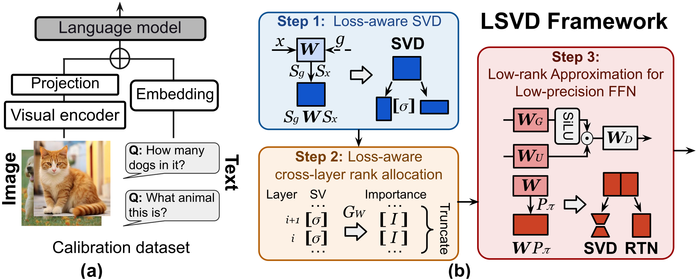

<div align="center">

# LSVD: Loss-Aware Low-Rank Approximation for Efficient Low-Precision Vision-Language Models

[](https://arxiv.org/html/2606.00573v2)
[](https://neurips.cc/virtual/2026/poster/153335)
[](https://huggingface.co/Etropyyy/LSVD)
[](LICENSE)

**Haiyu Wang**<sup>1</sup>, **Yutong Wang**<sup>1\*</sup>, **Leshu Li**<sup>2\*</sup>, **Yihui Ren**<sup>3</sup>, **Sai Qian Zhang**<sup>1,2</sup>

<sup>1</sup>Tandon School of Engineering, New York University &nbsp;&nbsp;
<sup>2</sup>Courant Institute of Mathematical Sciences, New York University &nbsp;&nbsp;
<sup>3</sup>Brookhaven National Laboratory<br>
<sup>\*</sup>Equal contribution

</div>

<p align="center">
  
</p>

Official implementation of **LSVD**, a loss-aware low-rank approximation framework for efficient low-precision
vision-language models (VLMs). 🎉 LSVD has been accepted to NeurIPS 2026.

## 🌟 Highlights

- **🎯 Loss-aware SVD.** Each attention head's Q/K/V projection is decomposed as $S_g W S_x$, where $S_x$ and $S_g$
  are Cholesky factors of the activation and output-gradient covariances (a Kronecker-factored second-order
  approximation of the loss), so the low-rank factors preserve accuracy rather than just the weights.
- **📊 Loss-aware rank allocation.** A calibration-gradient importance score makes ranks comparable across layers
  and heads and allocates the parameter budget globally.
- **🧩 Hybrid low-rank FFN.** Each FFN channel goes to an SVD or an RTN branch, whichever it tolerates better.
- **🔢 Low precision.** QuaRot rotation, RTN W8A8 quantization and quantization-aware whitening (QAW).
- **🏎️ Fast decoding.** With fused [Triton kernels](kernels/README.md), 4.7× faster than Flash Decoding and 2.3×
  faster than WSVD (LLaVA-Next 7B, RTX 4090 / 5090).

## 🔧 Installation

```bash
conda create -n lsvd python=3.10 -y && conda activate lsvd
# PyTorch with the CUDA build for your driver (paper: torch 2.10.0 + CUDA 13.0)
pip install torch==2.10.0 torchvision==0.25.0 --index-url https://download.pytorch.org/whl/cu130
pip install -r requirements.txt
# LLaVA (no deps), VLMEvalKit and fast-hadamard-transform at pinned commits + local patches
bash scripts/setup/install_third_party.sh
```

[`third_party/README.md`](third_party/README.md) lists the pinned commits and what the local patches change.

## 📁 Data

**Calibration: ScienceQA train.** LSVD uses 256 random samples of the 6218 image-grounded training problems.

```bash
bash scripts/setup/download_sqa_train.sh
bash scripts/setup/convert_sqa_train.sh   # writes data/scienceqa/llava_train_QCM-LEA.json and checks its md5
```

**Evaluation: VLMEvalKit.** ScienceQA-IMG (`ScienceQA_TEST`), SEED-Bench-IMG (`SEEDBench_IMG`) and MMBench EN
v1.1 (`MMBench_TEST_EN_V11`). VLMEvalKit downloads the TSVs into `$LMUData` on first use;
[`third_party/README.md`](third_party/README.md) lists the md5 of the files used in the paper.

## ⚡ Quick start with precomputed calibration caches

The calibration statistics (activation and output-gradient Cholesky factors, Fisher information, importance
scores) are the most expensive part of a run. We release them for the W8A8 runs of the three LLaVA models, together
with the hybrid-FFN channel groups, on [Hugging Face](https://huggingface.co/Etropyyy/LSVD).

| Model | Calibration caches (`$LSVD_CALIB_CACHE_DIR`) | Channel groups (`$LSVD_GROUPS_DIR`) |
|---|---|---|
| LLaVA-v1.5 7B | `llava15_7b/` (4.5 GB) | `hybrid_groups_llava15_7b.json` |
| LLaVA-Next 7B | `llavanext_7b/` (4.5 GB) | `hybrid_groups_llavanext_7b.json` |
| LLaVA-Next 13B | `llavanext_13b/` (8.7 GB) | `hybrid_groups_llavanext_13b.json` |

Each cache directory holds `act_input.pt`, `output_grad.pt`, `grad_info.pt`, `grad_scores.pt` and
`calib_cache.json` (the calibration settings and the sha256 of the files).

```bash
# all three models (17.8 GB); one model: --include "calib_cache/llava15_7b/*" "groups/*"
hf download Etropyyy/LSVD --local-dir lsvd_artifacts
export LSVD_CALIB_CACHE_DIR=$PWD/lsvd_artifacts/calib_cache LSVD_GROUPS_DIR=$PWD/lsvd_artifacts/groups
MODEL=llava15_7b EVAL_DATASET=ScienceQA_TEST bash scripts/lsvd/w8a8.sh
```

`w8a8.sh` reads the caches read-only (`--calib_cache_dir $LSVD_CALIB_CACHE_DIR/<model>`) and runs with the seed
they were computed with (`CALIB_SEED` in `w8a8.sh`), which also fixes the random rotation and the hybrid-FFN
calibration samples. Runs whose calibration settings differ from `calib_cache.json` (e.g. `--no-act_calib_fake_quant`)
stop with an error.

## ▶️ Running

All scripts run from the repository root. Run parameters are environment variables or `KEY=VALUE` arguments;
any other argument is appended to the python command line.

```bash
# LSVD-noQ (FP16), rho_1 = 90% ... 50%
for m in smolvlm qwen2vl_7b llava15_7b llavanext_7b llavanext_13b; do
  for ds in ScienceQA_TEST SEEDBench_IMG MMBench_TEST_EN_V11; do
    MODEL=$m RATIO="0.9 0.8 0.7 0.6 0.5" EVAL_DATASET=$ds bash scripts/lsvd/fp16.sh
  done
done

# LSVD (W8A8, hybrid FFN), rho_1 = 50%; needs the channel-group JSONs
for m in llava15_7b llavanext_7b llavanext_13b; do
  for ds in ScienceQA_TEST SEEDBench_IMG MMBench_TEST_EN_V11; do
    MODEL=$m EVAL_DATASET=$ds bash scripts/lsvd/w8a8.sh
  done
done

# W8A8 without quantization-aware whitening
MODEL=llava15_7b bash scripts/lsvd/w8a8.sh --no-act_calib_fake_quant

# Rebuild a channel-group JSON (Phase 1 of the hybrid FFN)
MODEL=llavanext_7b bash scripts/lsvd/ffn_groups.sh

# Print the python command without running it
LSVD_DRY_RUN=1 MODEL=llava15_7b bash scripts/lsvd/w8a8.sh
```

Results and logs go to
`fake_quant/utils/experiments/<HF model id>/W<w>A<a>K16V16lsvd/{fp16,w8a8}/<sqa|seed|mmbench>/ratio<r>/seed<s>/`.
Calibration statistics are computed on the first run of a model and cached in
`fake_quant/utils/experiments/<HF model id>/shared_cache/` for later runs with the same model, seed and bit widths.
Scores may differ with the GPU type and software versions.

<details>
<summary><b>Run parameters</b></summary>

| Parameter | Default | Meaning |
|---|---|---|
| `MODEL` | (required) | `llava15_7b`, `llavanext_7b`, `llavanext_13b`, `qwen2vl_7b`, `smolvlm` (`w8a8.sh`, `ffn_groups.sh`: the three LLaVA models) |
| `SEED` | `0` | calibration seed; a space-separated list runs one job per seed (not with `LSVD_CALIB_CACHE_DIR`) |
| `RATIO` | `0.5` | parameter ratio rho_1; a space-separated list runs one job per ratio |
| `EVAL_DATASET` | `ScienceQA_TEST` | `ScienceQA_TEST`, `SEEDBench_IMG` or `MMBench_TEST_EN_V11` |

</details>

<details>
<summary><b>Environment variables</b></summary>

| Variable | Meaning |
|---|---|
| `HF_HOME` | HuggingFace cache; models are downloaded on first use |
| `LMUData` | VLMEvalKit data directory (`ScienceQA_TEST.tsv`, `SEEDBench_IMG.tsv`, `MMBench_TEST_EN_V11.tsv`) |
| `WSVD_LMUDATA_ROOT` | optional; same directory as `LMUData`, needed only if VLMEvalKit's `.env` overrides `LMUData` |
| `LSVD_DATA_ROOT` | where `scripts/setup/` stores ScienceQA train (default `<repo>/data`) |
| `LSVD_GROUPS_DIR` | hybrid-FFN channel-group JSONs (default `<repo>/groups`) |
| `LSVD_CALIB_CACHE_DIR` | optional; released calibration caches, one subdirectory per model |
| `LSVD_CACHE_DIR` | optional; if set, `fake_quant/utils/experiments` is created as a symlink to it |
| `LSVD_DRY_RUN=1` | print the python command lines instead of running them |

</details>

## 🏎️ Decoding latency

LSVD's Triton kernels and the layer-wise latency benchmark (Fig. 5; LSVD against Eager attention and Flash
Decoding) are in [`kernels/`](kernels/README.md):

```bash
bash kernels/run_fig5.sh
```

## 🛠 Main arguments

The scripts call `fake_quant/main_<model>.py` (FP16) and `fake_quant/main_<model>_hybrid_ffn.py` (W8A8); see
`scripts/lsvd/*.sh` for the full command lines. The arguments that define LSVD:

| Arguments | Role |
|---|---|
| `--svd_lm --svd_modules qkv --is_per_head_svd` | per-head SVD of the Q/K/V projections |
| `--act_aware --calib_method cholesky --loss_aware` | loss-aware SVD ($S_g W S_x$) |
| `--grad_info --taylor_order 2` | importance-score rank allocation |
| `--rank_ratio 0.5 --use_true_param_ratio` | parameter ratio rho_1 of the Q/K/V projections |
| `--cal_dataset ScienceQA_Train --nsamples 256 --seed <s>` | calibration data |
| `--rotate --w_rtn --w_bits 8 --a_bits 8` | QuaRot rotation and RTN W8A8 quantization |
| `--act_calib_fake_quant` | quantization-aware whitening |
| `--use_hybrid_ffn --hybrid_ffn_groups_path <json>` | hybrid SVD + RTN FFN with the given channel groups (`--svd_ffn_ratio`, `--hybrid_ffn_rank_ratio` set its budget) |
| `--calib_cache_dir <dir>` | read the released calibration caches |

## 🗂️ Repository layout

```
fake_quant/            accuracy experiments (fake quantization); entry points run from here
  main_llava.py              LLaVA-v1.5
  main_llava_next.py         LLaVA-Next
  main_qwen2vl.py            Qwen2-VL
  main_smolvlm.py            SmolVLM
  main_*_hybrid_ffn.py       same, plus the hybrid SVD + RTN FFN
  utils/                     SVD, calibration, rank allocation, rotation, quantization, evaluation
  tests/                     CPU unit tests (cd fake_quant && python -m pytest -q tests)
scripts/lsvd/          run scripts: fp16.sh, w8a8.sh, ffn_groups.sh, common.sh
scripts/setup/         ScienceQA-train preparation, third-party installation
scripts/slurm_template.sbatch   optional SLURM wrapper
third_party/           pinned LLaVA / VLMEvalKit / fast-hadamard-transform + local patches
kernels/               Triton kernels and the decoding-latency benchmark (see kernels/README.md)
assets/                README figures
```

## 📚 Citation

If you find LSVD useful, please cite:

```bibtex
@inproceedings{wang2026lsvd,
  title     = {{LSVD}: Loss-Aware Low-Rank Approximation for Efficient Low-Precision Vision-Language Models},
  author    = {Wang, Haiyu and Wang, Yutong and Li, Leshu and Ren, Yihui and Zhang, Sai Qian},
  booktitle = {Advances in Neural Information Processing Systems (NeurIPS)},
  year      = {2026}
}
```

## 🤝 Acknowledgements

This code builds on [WSVD](https://openreview.net/forum?id=zrmQ4koOw9), [QSVD](https://github.com/SAI-Lab-NYU/QSVD),
[QuaRot](https://github.com/spcl/QuaRot), [SVD-LLM](https://github.com/AIoT-MLSys-Lab/SVD-LLM),
[ASVD](https://github.com/hahnyuan/ASVD4LLM), [LLaVA](https://github.com/haotian-liu/LLaVA),
[VLMEvalKit](https://github.com/open-compass/VLMEvalKit) and [LightLLM](https://github.com/ModelTC/LightLLM); see
[`NOTICE`](NOTICE). We thank the authors of these projects.

## 📄 License

Apache License 2.0; see [`LICENSE`](LICENSE).
